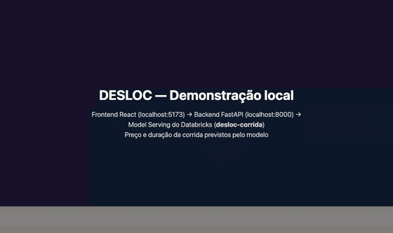

# DESLOC — Previsão de preço e duração de corridas (MLOps)

**Instituição:** Faculdade ESUDA · **Pós-graduação:** Engenharia de Software · **Disciplina:** MLOps
**Autor:** Luis Felipe Nunes

Simulador de mobilidade em que o passageiro escolhe origem e destino em São Paulo e recebe o **valor** e o **tempo** estimados da corrida, previstos por modelos treinados e servidos no **Databricks** (Unity Catalog + MLflow + Model Serving).

| | |
|---|---|
| **Vídeo da demonstração local (MP4, 1min24s)** | [Assistir / baixar](https://raw.githubusercontent.com/lip3bit/desloc-mlops/main/assets/demo-aplicacao.mp4) · prévia animada logo abaixo |
| **Deploy público** | Não publicado: o enunciado aceita o vídeo da demonstração local. A configuração está pronta em [`render.yaml`](render.yaml) (backend) e [`frontend/vercel.json`](frontend/vercel.json) |
| **Documentação da API (Swagger)** | `http://localhost:8000/docs` (ou pelo link no rodapé do app) |
| **Especificação (spec-kit)** | [specs/001-previsao-corrida](specs/001-previsao-corrida/spec.md) |

### Demonstração



*Prévia acelerada (3×). O vídeo completo mostra três corridas cotadas pelo app (busca de endereço e cliques no mapa) e, em seguida, o backend funcionando no **Swagger**: `GET /api/health` e `POST /api/v1/estimativa` executados com "Try it out", retornando o preço e a duração previstos pelo modelo `desloc-corrida` do Databricks.*

---

## 1. Atendimento ao enunciado

| Requisito | Como foi atendido |
|---|---|
| **1.** Criar a feature **duração**, que só existe após a corrida, com um algoritmo baseado em lat/long e corridas realizadas | [`09_modelo_duracao`](notebooks/09_modelo_duracao.ipynb): 5 modelos comparados por validação cruzada; regressão linear escolhida (MAE **2,67 min** contra 3,17 da média); previsões **out-of-fold** em `desloc.gold.duracao_oof`; modelo `desloc.models.duracao_corrida` |
| **1a.** Usar a saída como feature do modelo de preço | [`11_modelo_preco_deploy`](notebooks/11_modelo_preco_deploy.ipynb): `duracao_estimada` entra no preço; MAE **R$ 0,62** (KNN da aula: R$ 1,82) |
| **1b.** Validar a hipótese "quanto mais demorada, mais lucramos" | [`10_validacao_hipotese`](notebooks/10_validacao_hipotese.ipynb): **confirmada para receita** (r = 0,50, p < 0,001; +R$ 0,07/min mesmo controlando a distância). A receita por minuto **cai** nas corridas longas, e **lucro não é validável** sem custos |
| **2.** App web estilo Uber: origem/destino → valor previsto pelo modelo | [`frontend/`](frontend) (React + Leaflet) + [`backend/`](backend) (FastAPI) consumindo o Model Serving |
| **3.** Código versionado no Git + URL do deploy ou vídeo | Este repositório (notebooks com as saídas da execução no Databricks, backend, frontend, infra e docs) e o vídeo do app rodando localmente e prevendo, em [`assets/demo-aplicacao.mp4`](assets/demo-aplicacao.mp4) |
| Serving do Databricks via API | [`scripts/serving_endpoint.py`](scripts/serving_endpoint.py): `POST /api/2.0/serving-endpoints`, `PUT .../config`, `POST /serving-endpoints/desloc-corrida/invocations` |

### Features e adicionais do projeto

- Notebooks do Databricks **versionados no Git com as saídas da execução** (01–08 das aulas + 00, 09, 10, 11): tabelas, métricas e gráficos aparecem direto no GitHub.
- **Correção do vazamento temporal**: o calendário usa o horário da solicitação (proxy `entrega − duração`), não o da entrega.
- **Modelo encadeado** (`mlflow.pyfunc`) duração → preço, servido por **Model Serving criado via API REST**, em vez de função SQL.
- **Testes automatizados**, **CI** (GitHub Actions), **Docker Compose** e **log de previsões** para monitoramento.
- Documentação no padrão **Spec-Driven Development** ([github/spec-kit](https://github.com/github/spec-kit)).

---

## 2. Arquitetura

```text
             Databricks (Free Edition)
 ┌──────────────────────────────────────────────────────────────────────┐
 │ transacao.csv ─► Bronze ─► Silver ─► Gold (EDA/ML) ─► 04–08 (aulas)  │
 │                    │                                                 │
 │                    └─► 09 duração ─► gold.duracao_oof ─┐             │
 │                        10 hipótese ─► gold.validacao_hipotese        │
 │                                                        ▼             │
 │        11 preço v2 ─► MLflow/UC: desloc.models.corrida_desloc        │
 │                                   │  (pyfunc: features→duração→preço)│
 │                                   ▼                                  │
 │                  Model Serving "desloc-corrida" (scale-to-zero)      │
 └──────────────────────────────────▲───────────────────────────────────┘
                                    │ REST /invocations (OAuth/token)
 React + Leaflet ──► FastAPI /api/v1/estimativa ──► log JSONL de previsões
  (Nominatim: endereços · OSRM: desenho da rota)
```

| Pasta | Conteúdo |
|---|---|
| [`notebooks/`](notebooks) | Pipeline Databricks: ingestão, medalhão, EDA, preparação, KNN das aulas, deploy e avaliação (01–08), features (00), duração (09), hipótese (10), preço v2 + Serving (11) |
| [`scripts/`](scripts) | `serving_endpoint.py`: Model Serving via API REST |
| [`backend/`](backend) | FastAPI: validação, chamada REST ao Serving com retry para *cold start*, log de previsões, Swagger interativo em `/docs`, testes |
| [`frontend/`](frontend) | React + Vite + Leaflet: busca de endereços, clique no mapa, rota, cartão de preço/tempo |
| [`specs/`](specs/001-previsao-corrida) + [`.specify/`](.specify/memory/constitution.md) | Constituição, spec, plano, pesquisa, modelo de dados, contrato, quickstart e tarefas |
| [`data/`](data) | Base bruta (104 corridas em São Paulo) |

---

## 3. Resultados

**Duração** (CV 5-fold, 103 corridas, sem o outlier de 106 min)

| Modelo | MAE (min) |
|---|---|
| Média (referência) | 3,17 |
| **Regressão linear** (distância, hora, dia da semana, período) | **2,67** |
| Random Forest | 2,91 |
| Gradient Boosting | 3,04 |
| KNN 5 | 3,25 |

**Preço** (CV 5-fold, mesmas dobras)

| Cenário | MAE (R$) |
|---|---|
| KNN da aula (calendário da entrega + coordenadas) | 1,82 |
| Regressão linear sem duração | 0,62 |
| **Regressão linear + `duracao_estimada` (publicado)** | **0,62** |
| Teste reservado (20%) do modelo publicado | 0,69 (RMSE 0,95) |

**Hipótese**: H0 rejeitada para **receita** (Pearson r = 0,50; Spearman ρ = 0,67; regressão múltipla +R$ 0,072/min, p ≈ 4×10⁻⁴). A receita por minuto cai de ≈ R$ 2,75 para ≈ R$ 1,54 entre o primeiro e o último quartil de duração. **Lucro não é validável**: a base não tem custos.

Detalhes e trade-offs em [research.md](specs/001-previsao-corrida/research.md).

---

## 4. Como executar

Passo a passo completo em [quickstart.md](specs/001-previsao-corrida/quickstart.md).

```bash
# 1) Login no Databricks (OAuth; nenhum token no repositório)
databricks auth login --profile DESLOC --host https://dbc-097964b0-0fea.cloud.databricks.com
cp .env.example .env

# 2) Backend
cd backend && python -m venv .venv && source .venv/bin/activate
pip install -r requirements.txt && uvicorn app.main:app --port 8000   # http://localhost:8000/docs

# 3) Frontend (outro terminal)
cd frontend && npm install && npm run dev                              # http://localhost:5173
```

Model Serving via API: `python scripts/serving_endpoint.py deploy | status | testar`.
Testes: `cd backend && pytest -q` · `cd frontend && npm run build`.

---

## 5. Limitações

- **104 corridas**, todas em São Paulo: o modelo não deve ser usado fora dessa região.
- O horário da solicitação é um **proxy** (`entrega − duração`); o tempo de espera do motorista é desconhecido.
- `vlr_pago` é **receita bruta**; conclusões sobre lucro exigem dados de custo.
- O endpoint usa *scale-to-zero* (Free Edition): a primeira chamada após inatividade pode levar alguns minutos.
- A Free Edition limita o uso de computação e pode suspender o workspace temporariamente, removendo os endpoints de serving e bloqueando novos até a liberação. Nesse caso a API responde que o endpoint de inferência não foi encontrado. Para republicar quando o workspace for liberado: `python scripts/serving_endpoint.py deploy` (o modelo continua registrado no Unity Catalog).

## 6. Tecnologias

Databricks (Unity Catalog, Delta, MLflow, Model Serving, Jobs serverless) · scikit-learn · statsmodels · FastAPI · httpx · databricks-sdk · pytest · React · TypeScript · Vite · Leaflet · OpenStreetMap/Nominatim · OSRM · Docker · GitHub Actions · Render · Vercel
